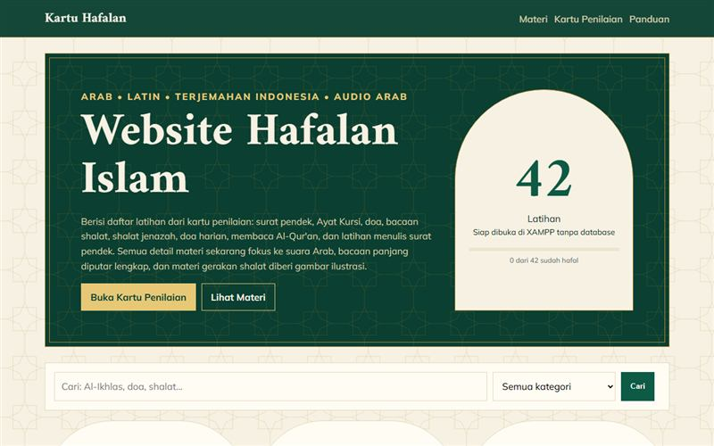

# Kartu Hafalan

Latihan hafalan surat, doa, dan bacaan shalat dengan audio Arab dan progres.

**Demo:** https://portofolio-jauza-fawaid.netlify.app/HAFALAN-ISLAM/

Website PHP sederhana untuk latihan hafalan Islam. Paket ini siap dipakai di XAMPP atau di-upload ke InfinityFree.

## Cara menjalankan di XAMPP

1. Extract ZIP ini.
2. Copy semua isi folder ke `xampp/htdocs/HAFALAN-ISLAM`.
3. Jalankan Apache dari XAMPP Control Panel.
4. Buka browser:

   `http://localhost/HAFALAN-ISLAM/`

## Cara upload ke InfinityFree

1. Buka File Manager InfinityFree.
2. Masuk ke folder `htdocs`.
3. Upload ZIP ini lalu extract.
4. Pastikan file `index.php`, `detail.php`, folder `assets`, `data`, dan `includes` berada langsung di `htdocs`.
5. Hapus file default InfinityFree seperti `index2.html` jika masih ada.

## Perbaikan audio versi ini

- Tombol Play, Pause, Stop, maju/mundur 10 detik, dan slider waktu tetap dipertahankan.
- Doa Harian dipisah menjadi 5 halaman doa, bukan digabung satu halaman.
- Doa Harian dan materi statis memakai audio lokal di `assets/audio/generated/`, jadi tidak bergantung pada suara browser.
- Surat Al-Qur'an memakai audio surat penuh dari MP3 publik, bukan dipisah per ayat.
- Ayat Kursi dan dua ayat terakhir Al-Baqarah disediakan audio lokal agar tetap bisa diputar.

## Catatan penting

- Audio doa dan materi non-surat memakai embed YouTube resmi, jadi perlu koneksi internet saat diputar.
- Surat Al-Quran tetap memakai audio qari dari sumber MP3 publik/API.
- Karena memakai YouTube embed, audio tidak diunduh dan tidak disimpan sebagai MP3 di website.

Audio lokal untuk doa/materi statis dibuat dari teks Arab agar semua halaman memiliki suara yang bisa langsung didengar. Untuk surat Al-Qur'an, audio qari asli tetap diambil dari sumber MP3 publik sehingga membutuhkan koneksi internet.
